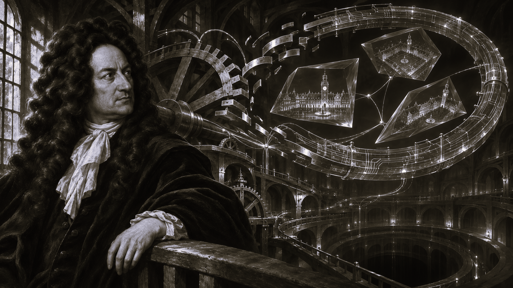

# What Leibniz’s *Monadology* Can Tell Us About Multi-Agent AI

*By Murat Durmus*

Imagine a machine that can think. Now enlarge it until you can walk inside, as you would walk into a mill. What would you expect to find?

Leibniz posed this thought experiment in his *Monadology* in 1714. Inside the mill, he argued, you would see parts pushing one another. You could watch the whole mechanism work and still be left wondering how it gives rise to experience.

To account for perception, Leibniz turned to *monads*, the simple substances he took to be the basic units of reality. Each monad expresses the same world from its own point of view, much as a city looks different depending on where you stand. Leibniz gives these perspectives a striking limitation:

> “Monads have no windows through which anything could enter or depart.”
>
> Gottfried Wilhelm Leibniz, *Monadology*, § 7

Now imagine a different mill. One AI agent proposes an answer. Another checks the literature. A third challenges the reasoning. These agents depend on the very thing Leibniz rules out for monads: they exchange messages that can change what each does next.

But how much does their agreement tell us? If all three rely on the same flawed source, one mistake can look like three independent judgments.

In *Inside the Super-Mill*, I use Leibniz’s two images to ask what makes distributed intelligence reliable and who bears responsibility when a conclusion emerges from many interacting parts.

## Read the full essay

- [English · Inside the Super-Mill (PDF)](Inside_the_Super-Mill.pdf)
- [Deutsch · Im Innern der Super-Mühle (PDF)](Im_Innern_der_Super-Muehle.pdf)
